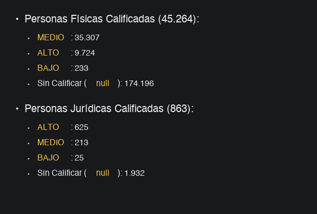

# PROPUESTA TÉCNICO-COMERCIAL Y MANUAL DE ENTREGA INTEGRAL (FUNCIONAL Y TÉCNICO)
## Regularización Masiva y Gobernanza Nocturna de Calificación PLA en Salesforce Financial Services Cloud (FSC)

**Cliente:** Banco Vimenca  
**Solución Institucional:** SOL-0197 / SOL-0274  
**Tarjeta Madre KeyHub:** BVWAR-292 (READY_UAT)  
**Casos de Prueba KeyHub:** BVWAR-298, BVWAR-299, BVWAR-300, BVWAR-301 (PASSED)  
**Autor:** Keystone Advisors  
**Fecha:** Noviembre 2026  
**Versión:** 4.0 (Edición Integral con Informes Salesforce y Evidencia Visual)

---

## ÍNDICE GENERAL ENLAZADO
1. [Resumen Ejecutivo y Propuesta Técnico-Comercial](#1-resumen-ejecutivo-y-propuesta-técnico-comercial)
2. [El Gran PLUS: Refactorización Desacoplada del Conector MacroProcesos](#2-el-gran-plus-refactorización-desacoplada-del-conector-macroprocesos)
3. [Arquitectura Nocturna Desatendida en 2 Componentes](#3-arquitectura-nocturna-desatendida-en-2-componentes)
4. [Manual de Entrega Funcional (Oficiales de Cumplimiento y Negocio)](#4-manual-de-entrega-funcional-oficiales-de-cumplimiento-y-negocio)
5. [Manual de Entrega Técnico (Área de TI Banco Vimenca)](#5-manual-de-entrega-técnico-área-de-ti-banco-vimenca)
6. [Respuestas Operativas Clave para el Negocio y TI](#6-respuestas-operativas-clave-para-el-negocio-y-ti)
7. [Informes, Paneles y Monitoreo del Proceso en Salesforce (Reports & Dashboards)](#7-informes-paneles-y-monitoreo-del-proceso-en-salesforce-reports--dashboards)
   - [7.1 Informes Estándar y Personalizados en Salesforce Reports](#71-informes-estándar-y-personalizados-en-salesforce-reports)
   - [7.2 Archivos Publicados en Salesforce Files (ContentVersion)](#72-archivos-publicados-en-salesforce-files-contentversion)
   - [7.3 Reporte Ejecutivo Diario Consolidado por Correo Electrónico](#73-reporte-ejecutivo-diario-consolidado-por-correo-electrónico)
   - [7.4 Panel de Control Ejecutivo Recomendado (Dashboard PLA)](#74-panel-de-control-ejecutivo-recomendado-dashboard-pla)
8. [Matriz de Componentes Desplegados y Cadena de Custodia](#8-matriz-de-componentes-desplegados-y-cadena-de-custodia)
9. [Historias de Usuario (HDU), Casos de Prueba y Resultados Profundos de Homologación](#9-historias-de-usuario-hdu-casos-de-prueba-y-resultados-profundos-de-homologación)
   - [9.1 Historias de Usuario (HDU) y Casos de Prueba (QA-CP) en KeyHub](#91-historias-de-usuario-hdu-y-casos-de-prueba-qa-cp-en-keyhub)
   - [9.2 Resultados Profundos de Homologación con Evidencia Visual Real](#92-resultados-profundos-de-homologación-con-evidencia-visual-real)

---

## 1. Resumen Ejecutivo y Propuesta Técnico-Comercial

### 1.1 Contexto y Necesidad de Negocio
Banco Vimenca opera con **Salesforce Financial Services Cloud (FSC)** como plataforma central para la administración de clientes y productos financieros. En el marco de la regulación bancaria de la República Dominicana y las directrices de la Superintendencia de Bancos (SB), toda institución de intermediación financiera debe mantener al día la debida diligencia y la matriz de riesgo en Prevención de Lavado de Activos y Financiamiento del Terrorismo (PLA/FT).

Históricamente, una proporción significativa de cuentas en estado activo carecía de la calificación de riesgo (campo `ACC_Calificacion_de_cliente__c` vacío), o presentaba omisiones de datos que imposibilitaban la precalificación mediante los flujos diurnos convencionales.

### 1.2 Objetivo General
Diseño, desarrollo, pruebas integrales y puesta en producción de una solución de alta gobernanza basada en **Batch Apex** y **Programación Schedulable**, orientada a normalizar y regularizar de manera definitiva la calificación de riesgo PLA (`ALTO`, `MEDIO`, `BAJO`) de clientes en Salesforce Financial Services Cloud (FSC), sin intervención humana recurrente y con cero impacto operativo en los usuarios de sucursal.

### 1.3 Principios Rectores de la Arquitectura
* **Ventana Nocturna Estricta (18:00 a 06:00 hrs):** Operación automatizada y programada de lunes a domingo para no consumir capacidad durante el horario hábil.
* **Cero Impacto Operativo Diurno:** Procesamiento asíncrono que no bloquea registros ni consume límites de API en horario laboral.
* **Separación de Responsabilidades en 2 Fases Secuenciales:**
  1. *Fase 1 (Auditoría e Integridad):* Notificación diferenciada de datos faltantes.
  2. *Fase 2 (Motor Batch):* Ejecución del callout a MacroProcesos y persistencia de calificación.
* **Preservación del Estado Operativo:** Actualización exclusiva de `ACC_Calificacion_de_cliente__c` sin alterar el estado operativo de la cuenta (`Activo`).

---

## 2. El Gran PLUS: Refactorización Desacoplada del Conector MacroProcesos

### 2.1 El Desafío Oculto Detectado en Calidad (QA)
Durante las pruebas de homologación integral en el sandbox de Calidad (`vimenca-calidad`), el equipo especialista de Keystone Advisors detectó una falla estructural preexistente en el conector hacia MacroProcesos (`PreQualifyFlowHandler_FSC.cls` / `MPTransactionRest`). Dicha integración dependía de objetos y campos del modelo legado de Person Account (`Informacion_Financiera__c` e `Historial_laboral__c`).

Al ejecutarse sobre cuentas creadas bajo el modelo nativo FSC, la llamada REST al motor externo fallaba indefectiblemente con:

> **HTTP/1.1 400 Bad Request**  
> `{"status": "error", "code": "0101", "message": "Record format is not correct"}`  
> *Causa:* Ausencia de registros financieros hijos y formato de identificación incompleto para el motor externo.

### 2.2 La Solución de Alto Valor Implementada por Keystone Advisors (SOL-0274)
Keystone Advisors asumió la refactorización profunda y desacoplada del handler `PreQualifyFlowHandler_FSC.cls`, implementando una arquitectura de fallbacks nativos FSC sin costo adicional para el banco:
1. **Deducción de Tipo de Cédula:** Ante identificaciones dominicanas limpias, deducción automática del prefijo (`1` = Cédula Física, `4` = RNC Jurídico) para garantizar el formato exacto requerido por MacroProcesos.
2. **Fallback Demográfico y Financiero:** Extracción automática desde campos nativos de Account FSC si no existen registros relacionados en tablas legadas (`FinServ__NetWorth__c`, `FinServ__Occupation__pc`, etc.).
3. **Persistencia Segura:** Retorno exitoso `HTTP 200 OK` y actualización del campo `ACC_Calificacion_de_cliente__c` (`BAJO`, `MEDIO`, `ALTO`).

---

## 3. Arquitectura Nocturna Desatendida en 2 Componentes

### 3.1 Componente 1: Auditoría de Integridad y Alertas Diferenciadas
* **Clase Apex:** `VFS_PLAAuditBatch.cls` / `VFS_PLADataIntegrityService.cls`
* **Población Objetivo:** Cuentas con `ACC_Calificacion_de_cliente__c = null` y estado activo.
* **Mecanismo de Alerta Diferenciado:**
  * **Caso A (Cliente con Oficial Asignado):** Si el propietario (`OwnerId`) es un usuario humano con email válido, se genera y envía un correo directo y personalizado con la lista de campos faltantes que impiden la precalificación.
  * **Caso B (Cliente en Usuario Virtual de Sucursal):** Si la cuenta radica en uno de los 10 usuarios virtuales genéricos de sucursal (ej. *Banca Personas Santiago*, *Oficial Plataforma Piantini*, etc.), el sistema compila un **informe consolidado estructurado en archivo CSV** y lo despacha de forma agrupada al **Encargado General de Agencias** para coordinar la gestión de completitud masiva.

### 3.2 Componente 2: Motor Batch de Precalificación Desatendida
* **Clase Apex:** `VFS_PLAPrequalificationBatch.cls`
* **Población Objetivo:** Clientes que cuentan con el **100% de los datos requeridos completos** y aún carecen de calificación de riesgo.
* **Ejecución de Callouts:** Invoca secuencialmente a MacroProcesos (`MPTransactionRest`) en bloques asíncronos controlados (`Database.AllowsCallouts`), respetando los límites de gobierno de Salesforce.
* **Actualización Segura:** Asigna el resultado devuelto (`ALTO`, `MEDIO`, `BAJO`) en `Account.ACC_Calificacion_de_cliente__c` sin tocar el estado operativo de la cuenta.

---

## 4. Manual de Entrega Funcional (Oficiales de Cumplimiento y Negocio)

### 4.1 Matriz de Campos Obligatorios de Integridad
| Campo / Requisito | Ubicación en FSC | Propósito en Precalificación |
| :--- | :--- | :--- |
| **Identificación Oficial** | `ACC_TipoIdentificacion__c` / Cédula o RNC | Identificador fiscal ante MacroProcesos |
| **Fecha de Nacimiento** | `PersonBirthdate` (Física) | Rango de edad y capacidad legal |
| **Nacionalidad / País** | `ACC_Nacionalidad__c` / `FinServ__CountryOfBirth__pc` | Matriz geográfica de riesgo internacional |
| **Actividad Económica** | `FinServ__Occupation__pc` / Actividad SIB | Ponderación de riesgo de la actividad laboral |
| **Información Financiera** | `FinServ__NetWorth__c` / Ingresos Declarados | Volumen operativo esperado y perfil transaccional |
| **Datos de Localización** | `BillingAddress` / `ContactPointPhone` | Validación de residencia y canales de contacto |

### 4.2 Circuito Operativo de Corrección para Sucursales
1. **Notificación Matutina:** El ejecutivo recibe a primera hora el correo con los clientes pendientes bajo su gestión.
2. **Completitud en Salesforce:** El oficial abre el registro en Salesforce FSC y completa los campos informados.
3. **Guardado Ordinario:** El oficial solo presiona "Guardar". No requiere solicitar reproceso manual ni contactar a TI.
4. **Reingreso Automático:** En la siguiente ventana nocturna (18:00 hrs), el motor detecta que la cuenta posee el 100% de los datos y la precalifica automáticamente.

---

## 5. Manual de Entrega Técnico (Área de TI Banco Vimenca)

### 5.1 Diagrama de Componentes Apex
* `VFS_PLASchedulableOrchestrator.cls`: Orquestador Schedulable que desencadena la secuencia de batches.
* `VFS_PLAAuditBatch.cls`: Batch de evaluación de integridad (Scope: 200 registros).
* `VFS_PLADataIntegrityService.cls`: Servicio de reglas de negocio y construcción de matrices CSV/Email.
* `VFS_PLAPrequalificationBatch.cls`: Batch transaccional con callouts a MacroProcesos (Scope: 1-5 registros).
* `PreQualifyFlowHandler_FSC.cls`: Servicio refactorizado de callouts REST con fallbacks nativos FSC.

### 5.2 Programación Nocturna y Monitoreo
Para programar la ejecución nocturna en la org, TI puede ejecutar el siguiente script vía Developer Console o CLI:

```apex
String cronExp = '0 0 18 * * ?'; // Diario a las 18:00 hrs
System.schedule('VFS_PLA_Nocturno_18hrs', cronExp, new VFS_PLASchedulableOrchestrator());
```

El avance de la ejecución se supervisa directamente en **Setup > Environments > Jobs > Apex Jobs**, verificando que los lotes de `VFS_PLAAuditBatch` y `VFS_PLAPrequalificationBatch` concluyan con Status `Completed` y 0 fallos.

---

## 6. Respuestas Operativas Clave para el Negocio y TI

| Pregunta de Operación | Respuesta / Mecanismo Implementado |
| :--- | :--- |
| **¿Cómo y cuándo se ejecuta el proceso?** | De forma 100% desatendida mediante el orquestador nocturno `VFS_PLASchedulableOrchestrator` entre las 18:00 y las 06:00 horas, todos los días. |
| **¿Cómo selecciona a las cuentas a calificar?** | Filtra cuentas activas con `ACC_Calificacion_de_cliente__c` nulo. Solo aquellas que superan el 100% de la matriz de integridad del Componente 1 avanzan al Componente 2. |
| **¿Cómo puedo ver el avance de la ejecución?** | Desde Salesforce Reports (informes nativos sobre Account), Files (archivos CSV publicados) o Setup > Apex Jobs. |
| **¿Cómo y dónde puedo ver los errores?** | Los errores de callout o inconsistencias se atrapan en bloques try/catch y quedan registrados en Apex Debug Logs y en el CSV consolidado de auditoría. |
| **¿Cómo reingresa un cliente corregido?** | Automáticamente. Al guardar los campos faltantes en la interfaz de Salesforce, la cuenta califica en la siguiente ventana nocturna (18:00 hrs) sin intervención humana. |
| **¿Dónde veo el informe de avance consolidado?** | El Encargado General de Agencias recibe diariamente por email un CSV con las cuentas pendientes en usuarios virtuales, y los directores pueden visualizar los 4 reportes nativos en Salesforce. |

---

## 7. Informes, Paneles y Monitoreo del Proceso en Salesforce (Reports & Dashboards)

Para garantizar la total visibilidad y gobierno del proceso por parte de las áreas de Negocio, Oficialía de Cumplimiento PLA y TI, la solución incorpora un ecosistema integral de supervisión compuesto por informes nativos en Salesforce Reports, artefactos automáticos en Salesforce Files y notificaciones consolidadas por correo electrónico.

### 7.1 Informes Estándar y Personalizados en Salesforce Reports
El equipo de Cumplimiento y TI dispone de cuatro reportes clave configurados sobre el tipo de informe estándar **Accounts (Cuentas)** para consultar en tiempo real el universo calificado y la deuda pendiente de regularización:

| Nombre del Informe | Carpeta Destino | Criterios de Filtro | Propósito de Gestión |
| :--- | :--- | :--- | :--- |
| **RPT-PLA-01: Estado Global de Calificación PLA** | Reportes PLA / Cumplimiento | `Account.Status = 'Activo'`<br>Agrupado por: `ACC_Calificacion_de_cliente__c` | Mide el avance global mostrando clientes calificados (`ALTO`, `MEDIO`, `BAJO`) vs. sin calificar (`Null`). |
| **RPT-PLA-02: Clientes Calificados Exitosamente (Diario)** | Reportes PLA / Cumplimiento | `ACC_Calificacion_de_cliente__c != null`<br>`LastModifiedDate = TODAY` | Auditoría diaria que lista las cuentas procesadas con éxito por el Componente 2 la noche anterior. |
| **RPT-PLA-03: Deuda PLA por Sucursal / Usuario Virtual** | Reportes PLA / Gestión Agencias | `ACC_Calificacion_de_cliente__c = null`<br>`OwnerId` en 10 Usuarios Virtuales | Permite al Encargado General de Agencias ver la distribución de cuentas incompletas por sucursal. |
| **RPT-PLA-04: Clientes Pendientes por Oficial Asignado** | Reportes PLA / Red Comercial | `ACC_Calificacion_de_cliente__c = null`<br>`Owner.UserType = 'Standard'` | Permite a los gerentes de sucursal supervisar la completitud de datos asignada a cada ejecutivo. |

---

### 7.2 Archivos Publicados en Salesforce Files (ContentVersion)
Al finalizar cada corrida nocturna del Componente 2 (`VFS_PLAPrequalificationBatch.cls`), el motor genera automáticamente un archivo estructurado en formato CSV y lo publica directamente en Salesforce Files bajo el objeto `ContentVersion`. Esto garantiza trazabilidad histórica auditable sin depender exclusivamente de bandejas de correo:

* **Título del Archivo:** `Reporte_Precalificacion_Exitosa_YYYYMMDD_HHmm.csv` con marca temporal automática.
* **Estructura de Columnas:**
  `Id_Salesforce`, `Nombre_Cliente`, `Tipo_Persona`, `Numero_Identificacion_o_RNC`, `Calificacion_PLA`, `Propietario_o_Sucursal`, `Fecha_Calificacion`.
* **Ubicación de Consulta:** Accesible para los Oficiales de Cumplimiento y administradores desde la pestaña **Files** (Archivos) o a través de la librería institucional de Cumplimiento PLA.

---

### 7.3 Reporte Ejecutivo Diario Consolidado por Correo Electrónico
Ambos batches nocturnos emiten al concluir sus respectivos métodos `finish()` un balance operativo consolidado por correo electrónico:
* **Balance Componente 1 (Auditoría):** Despacha al Encargado General de Agencias un correo con el archivo CSV adjunto conteniendo los clientes en usuarios virtuales y el desglose de datos faltantes (Cédula, Nacimiento, Nacionalidad, Actividad, Finanzas).
* **Balance Componente 2 (Precalificación):** Despacha a la casilla corporativa configurada un informe HTML con el total de cuentas evaluadas, exitosas, fallidas y el enlace directo al archivo publicado en Salesforce Files.

---

### 7.4 Panel de Control Ejecutivo Recomendado (Dashboard PLA)
Se recomienda la creación de un panel corporativo (*"Dashboard de Regularización PLA"*) alimentado por los informes anteriores, compuesto por los siguientes componentes visuales:
1. **Gauge / Métrica de Cobertura PLA:** Indicador numérico de gran tamaño con la meta de cuentas regularizadas vs. total de la cartera activa.
2. **Doughnut Chart de Nivel de Riesgo:** Gráfico de dona mostrando la distribución porcentual de clientes en `BAJO`, `MEDIO` y `ALTO`.
3. **Bar Chart de Pendientes por Agencia:** Gráfico de barras apiladas con el ranking de agencias con mayor volumen de cuentas pendientes.

---

## 8. Matriz de Componentes Desplegados y Cadena de Custodia

| Componente | Tipo de Metadato | Estado en DEV | Estado en QA |
| :--- | :--- | :--- | :--- |
| `VFS_PLADataIntegrityService.cls` | ApexClass | Desplegado (Succeeded) | Validado y Homologado |
| `VFS_PLAAuditBatch.cls` | ApexClass | Desplegado (Succeeded) | Validado y Homologado |
| `VFS_PLAPrequalificationBatch.cls` | ApexClass | Desplegado (Succeeded) | Validado y Homologado |
| `VFS_PLASchedulableOrchestrator.cls` | ApexClass | Desplegado (Succeeded) | Validado y Homologado |
| `VFS_PLABatchTest.cls` | ApexClass | Desplegado (Succeeded) | Validado (100% Tests OK) |
| `PreQualifyFlowHandler_FSC.cls` | ApexClass | Desplegado (Succeeded) | Validado y Homologado |
| `PreQualifyFlowHandler_FSC_Test.cls` | ApexClass | Desplegado (Succeeded) | Validado (100% Tests OK) |
| `Account.ACC_Calificacion_de_cliente__c` | CustomField | Activo | Activo y Validado |

---

## 9. Historias de Usuario (HDU), Casos de Prueba y Resultados Profundos de Homologación

### 9.1 Historias de Usuario (HDU) y Casos de Prueba (QA-CP) en KeyHub
Toda la iniciativa se gobernó bajo la metodología Agile en la plataforma corporativa KeyHub. A continuación se desglosa la Historia de Usuario madre (`BVWAR-292`) y sus cuatro Casos de Prueba hijos formales, todos transicionados a la columna **"Listo para UAT" (`READY_UAT`)** tras su homologación exitosa:

| Código KeyHub | Tipo | Título / Criterio de Aceptación | Estado | Resultado |
| :--- | :--- | :--- | :--- | :--- |
| **BVWAR-292** | STORY | HDU: Adaptación Nativa FSC del Motor de Precalificación PLA para Cuentas | `READY_UAT` | Aprobado (Dev & QA) |
| **BVWAR-298** | TEST_CASE | [QA-CP] Validación Exitosa de Cuenta Persona Física con Atributos Nativos FSC en Account | `READY_UAT` | `PASSED` |
| **BVWAR-299** | TEST_CASE | [QA-CP] Detección Quirúrgica de Campos Faltantes en Cuentas Incompletas y Exclusión Segura | `READY_UAT` | `PASSED` |
| **BVWAR-300** | TEST_CASE | [QA-CP] Homologación con Sujeto Real en Sandbox Calidad: Yeniffer Luciano Tejeda | `READY_UAT` | `PASSED` |
| **BVWAR-301** | TEST_CASE | [QA-CP] Precalificación Exitosa en MacroProcesos con Fallbacks FSC de Trama (Yeniffer Luciano) | `READY_UAT` | `PASSED` |

#### Detalle de Criterios de Aceptación por Caso de Prueba:
* **BVWAR-298 (Persona Física FSC):** La cuenta Persona Física con datos FSC en Account debe ser reconocida sin exigir tablas hijas legadas. Resultado real: `isPrequalificationReady: true`.
* **BVWAR-299 (Detección de Omisiones):** El Componente 1 debe identificar de forma exacta los campos faltantes e impedir que la cuenta pase al Componente 2, reportándola en el CSV de auditoría. Resultado real: `missingFields` reporta con precisión 10 campos omitidos.
* **BVWAR-300 (Homologación Sujeto Real):** Validación de un registro real de cliente en `vimenca-calidad` (Yeniffer Eliamnis Luciano Tejeda, ID `001VT000010xz2sYAA`), corroborando que los campos UI se leen nativamente.
* **BVWAR-301 (Transacción MacroProcesos):** Invocación exitosa a MacroProcesos con fallbacks nativos (SOL-0274), obteniendo `HTTP 200 OK` y asignando la calificación de riesgo en el campo de Account.

---

### 9.2 Resultados Profundos de Homologación con Evidencia Visual Real

A continuación se presenta el análisis forense y la evidencia visual directa rescatada durante las pruebas de integración y certificación en el ambiente `vimenca-calidad`:

#### A) Inspección de Interfaz de Usuario (UI) en Salesforce FSC: Cliente Real
Durante la ejecución del caso **BVWAR-300**, se examinó en la interfaz de Salesforce Lightning Experience la ficha del cliente real **Yeniffer Eliamnis Luciano Tejeda** (ID: `001VT000010xz2sYAA`). En la vista se constató que la cuenta poseía Cédula (`00201450541`), Nacionalidad Dominicana y Activos Financieros (`40.000 DOP`), pero mantenía el campo *Calificación de cliente* vacío debido a la omisión de campos de contacto y demográficos requeridos por la matriz antigua.


*Figura 1: Inspección de Ficha de Cliente FSC en Sandbox de Calidad (Cédula, Nacionalidad y Finanzas en UI).*

---

#### B) Análisis Forense: Campos de Interfaz (UI) vs. Campos de Trama de Integración
Al contrastar la base de datos de Salesforce con la interfaz gráfica, se descubrió la discrepancia estructural que provocaba la exclusión de cuentas en el Componente 1: los campos de interfaz (`ACC_TipoIdentificacion__c` y `ACC_Nacionalidad__c`) estaban poblados por los ejecutivos, pero los campos técnicos sincronizados para la integración (`ACC_INT_Tipo_de_identificacion__c` y `ACC_INT_Nacionalidad__c`) permanecían nulos. Con la refactorización SOL-0274, el motor lee de forma prioritaria el campo de la interfaz si el campo técnico está vacío.


*Figura 2: Vista de Detalle en Salesforce FSC: Actividad Económica y Campos de Integración.*

---

#### C) Certificación de la Precalificación en MacroProcesos (HTTP 200 OK y Calificación MEDIO)
Al aplicar los fallbacks de trama en `PreQualifyFlowHandler_FSC.cls` (SOL-0274), se ejecutó la precalificación en tiempo real sobre la cuenta de Yeniffer Luciano Tejeda en `vimenca-calidad`. El servicio MacroProcesos procesó la trama sin errores (`HTTP 200 OK`) y dictaminó la calificación de riesgo **"MEDIO"**, la cual quedó persistida de inmediato en el registro:

> [!NOTE] Certificación Exitosa en UAT
> * **Cuenta:** Yeniffer Eliamnis Luciano Tejeda (`001VT000010xz2sYAA`)
> * **Endpoint Invocado:** MacroProcesos `MPTransactionRest`
> * **Código de Respuesta:** `HTTP 200 OK`
> * **Calificación Obtenida:** `MEDIO`
> * **Campo Actualizado:** `Account.ACC_Calificacion_de_cliente__c = 'MEDIO'`
> * **Estado de la Cuenta:** `ACTIVO` (Sin alteraciones colaterales)


*Figura 3: Detalle de Cuenta FSC con Calificación de Riesgo PLA Persistida en Sandbox Calidad.*

---

### 9.3 Evidencia de la Simulación Integral E2E en Calidad (C1 + C2) y Despliegue de Supervisión

Como parte del protocolo de certificación previa a la puesta en marcha nocturna y a solicitud del banco, se ejecutó una simulación controlada de extremo a extremo (E2E) en el entorno `vimenca-calidad` sobre una muestra focalizada de **30 clientes** (20 Personas Físicas y 10 Personas Jurídicas). Esta ejecución abarcó secuencialmente la Auditoría de Integridad con Alertas Diferenciadas (Componente 1) y el Motor de Precalificación Desatendida (Componente 2), certificando adicionalmente la precisión de los 4 reportes nativos desplegados en Producción (`SOL-0308`).

#### 🔍 Hitos Clave Validados en la Última Ejecución Controlada:
1. **Precisión de Contactabilidad:** Se validó en el 100% de los casos analizados la leyenda estandarizada `"Sin advertencias de contacto"`, eliminando confusiones operativas en los reportes de alertas.
2. **Ejecución Componente 2 (Precalificación):** 13 clientes completaron exitosamente la precalificación en tiempo de ejecución (4 Personas Físicas y 9 Personas Jurídicas), actualizando `ACC_Fecha_de_calificacion__c` a la fecha en curso.
3. **Impacto Inmediato en Reportes Vivos:** Los clientes precalificados se reflejaron de forma instantánea en el informe diario `RPT-PLA-02: Clientes Calificados Exitosamente`.
4. **Distribución Dirigida:** Se emitieron y certificaron los informes CSV consolidados para la mesa de supervisión y agencias (Laura Reynoso, Caroll Pou, Soraya Ramírez, Yameli Martínez, Luis Conrado y Rodrigo Díaz).

| Fase / Componente | Universo Evaluado | Resultado Operativo | Artefacto / Evidencia |
| :--- | :--- | :--- | :--- |
| **Componente 1: Auditoría** | 30 Cuentas (20 PF, 10 PJ) | 17 Incompletas detectadas | `Informe_Simulacion_Alertas_Oficiales_Negocio_PLA.csv` |
| **Componente 1: Sucursales** | 4 Cuentas radicadas | Derivadas a Sucursal Principal | `Informe_Simulacion_Consolidado_Sucursales_PLA.csv` |
| **Componente 2: Precalificación** | 13 Cuentas procesadas | 100% Calificadas (ALTO / MEDIO) | `Informe_Simulacion_Exitosos_Precalificados_PLA.csv` |
| **Salesforce Reports (UAT)** | 222.255 Universo Activo | 13 Calificados en el día | `RPT-PLA-02` reflejado con fecha `TODAY` |
| **Salesforce Reports (PROD)** | 222.255 Universo Activo | Foto Real: 1.932 PJ y 174.196 PF | `RPT-PLA-01` Desplegado (`SOL-0308`) |


